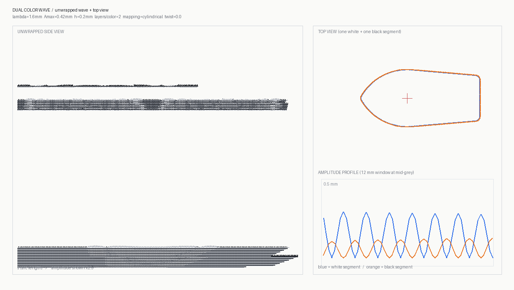
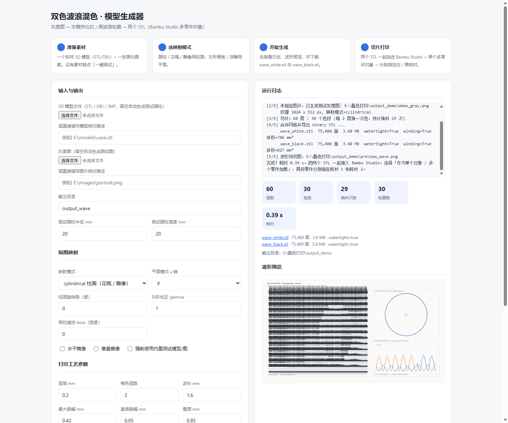
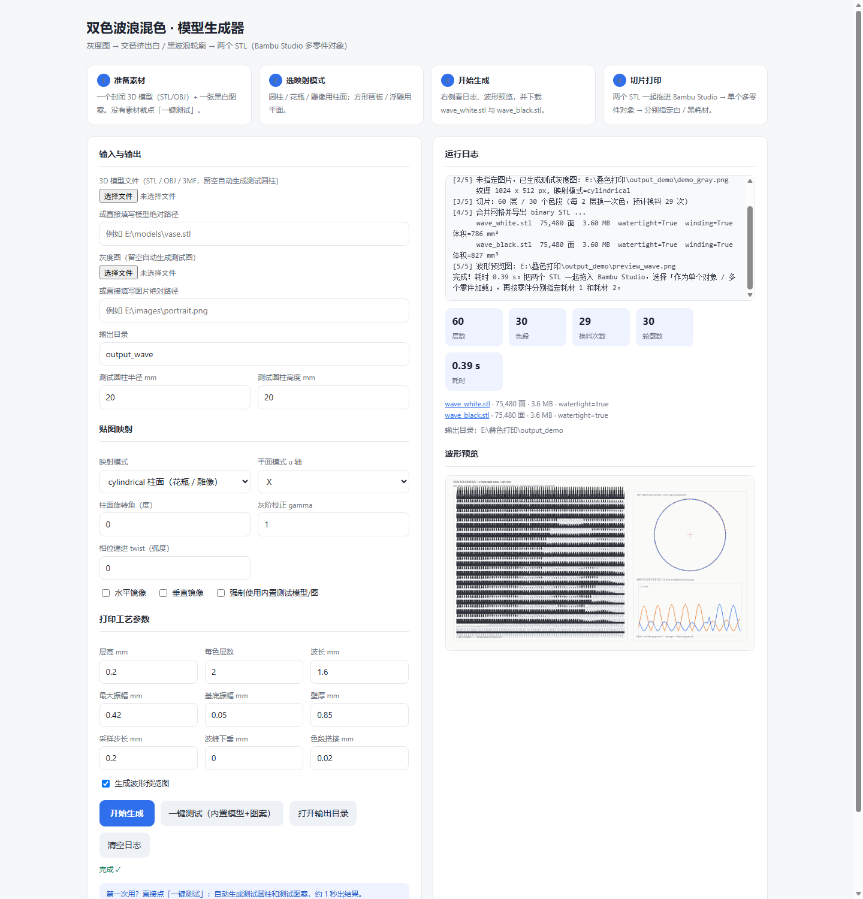

# Dual Color Wave · 双色波浪混色 3D 打印生成器

[](https://github.com/yinbaozong/dual-color-wave/actions/workflows/test.yml)
[](LICENSE)
[](pyproject.toml)

把 **一张灰度图 + 一个封闭 3D 模型** 变成两个可直接切片打印的 STL：
黑白两色按层交替挤出，外轮廓被灰度控制的正弦波浪调制——远看就是模型表面
浮现出的那张灰阶图像。灵感来自 ACM SIGGRAPH 2025 公开研究成果
（Surface Palettes）的「波浪形双色表面」思想，本仓库是其工程化实现。



**工作原理（5 步管线）**

1. 按「色段」做水平截面，取外轮廓；
2. 等弧长重采样，起点按极角对齐（保证波峰沿同一母线竖直编织）；
3. 柱面 / 平面 UV 映射，采样灰度 $I\in[0,1]$；
4. 正弦法向调制：白层振幅 ∝ $I$，黑层振幅 ∝ $1-I$，两层相位相差 $\pi$，
   从远处两种颜色的面积比混合出灰阶；
5. 厚壁扫掠生成 watertight 环形棱柱，按颜色合并导出。

适合拓竹 Bambu Lab（单喷头 + AMS，或 H2D 双喷头）以及任何支持
「单对象多零件、按零件换色」的切片软件。

## 特性

- **零素材也能跑**：`--demo` 自动生成测试圆柱与测试灰度图，约 1 秒出结果
- **两种贴图映射**：`cylindrical` 柱面（花瓶 / 雕像 / 圆柱）与 `planar` 平面（画板 / 浮雕）
- **参数全开放**：波长、振幅、层高、每色层数、壁厚、灰阶 gamma 校正、斜纹 twist、波峰下垂等
- **可预测的工艺指标**：自动报告层数、色段数、**换料次数**、面数、体积、watertight 检查
- **波形预览图**：展开图 + 俯视图 + 振幅剖面，不打印也能看效果
- **本地网页 UI**：上传文件、调参数、看日志、下载 STL，双击即用
- **纯 Python 栈**：numpy / trimesh / shapely / pillow，无需任何 C 编译

## 安装

需要 Python 3.10+（3.13 已验证）：

```bash
git clone https://github.com/yinbaozong/dual-color-wave.git
cd dual-color-wave
python -m pip install -r requirements.txt
```

国内网络建议用镜像：`python -m pip install -r requirements.txt -i https://mirrors.aliyun.com/pypi/simple/`

## 快速开始

### 1) 命令行

```bash
# 一键测试：自动生成测试圆柱 + 测试图，输出 output_wave/wave_white.stl & wave_black.stl
python dual_color_wave.py --demo

# 正式使用：花瓶/雕像用柱面映射
python dual_color_wave.py --model vase.stl --image portrait.png --output out1

# 方形画板/浮雕用平面映射
python dual_color_wave.py --model board.stl --image logo.png --mapping planar --output out2

# 换风格：更细的颗粒 + 斜纹
python dual_color_wave.py --demo --wavelength 1.2 --twist 0.35

python dual_color_wave.py --help     # 全部参数
```

### 2) 网页 UI（推荐新手）

```bash
python dual_color_wave.py --gui       # 或 python wave_gui.py
```

Windows 用户直接双击 **`启动UI.bat`** 即可。



上传模型和图案（或点「一键测试」）→ 点「开始生成」→ 右侧下载两个 STL。



## 导入 Bambu Studio

1. 把 `wave_white.stl` 和 `wave_black.stl` **同时**拖入，弹窗选
   **「作为单个对象（多个零件）加载」**；
2. 对象列表里分别给两个零件指定白色、黑色耗材（AMS 槽位）；
3. 切片层高必须与生成时一致（默认 0.2 mm），**关闭自适应层高**；
4. 0.4 mm 喷嘴、墙线数 ≥ 2、填充可 0%；切片预览里应看到每层交替换色、外壁呈波浪。

## 参数速查

| 参数 | 默认 | 说明 |
|---|---|---|
| `--layer-height` | 0.2 | 切片层高 mm，必须与 Bambu Studio 一致 |
| `--layers-per-color` | 2 | 每几层换一次色；1 = 每层换（H2D 双喷头适用），2~4 平衡 AMS 换料时间 |
| `--wavelength` | 1.6 | 波浪周期 mm；1.2 更细腻，2.0 更粗犷 |
| `--max-amplitude` | 0.42 | 最大外凸振幅 mm；略大于半个喷嘴直径（0.35~0.50） |
| `--min-amplitude` | 0.05 | 基底偏移 mm，保证弱色一侧仍有连续细线 |
| `--wall-thickness` | 0.85 | 实体壁厚 mm；≥ 2 条壁线宽，凹多模型请调小 |
| `--mapping` | cylindrical | `cylindrical` 柱面 / `planar` 平面 |
| `--gamma` | 1.0 | 灰阶校正；0.6~0.9 提亮图案细节，1.1~1.6 加深 |
| `--twist` | 0 | 每色段相位递进（弧度）；0 = 竖直编织，0.2~0.5 = 斜纹 |
| `--droop` | 0 | 波峰沿 Z 下垂 mm，制造交叉搭接的编织感 |
| `--angle-offset` | 0 | 柱面贴图起始角（度），旋转图案在圆柱上的方位 |
| `--flip-u` / `--flip-v` | off | 贴图水平 / 垂直镜像 |

## 调参经验

- **先打小样**：`--demo-height 8~12` 出一个小样件试印，比改大件省时得多；
- **换料次数 = 色段数 − 1**，AMS 每次约 1~2 分钟。60 mm 高、每 2 层换色 ≈ 149 次；
  时间敏感就加大 `--layers-per-color`（纵向灰阶分辨率会变粗）；
- 图案对比度不够：调 `--gamma`，或直接在图像软件里拉对比度；
- 圆柱一圈周长尽量是波长的整数倍，接缝处才不会出现错位斑块。

## FAQ

- **必须 AMS 吗？** 不必须。任何能按零件换色的方案都行：AMS、多盘料、双喷头，
  甚至手动中途换料（小件可行）。
- **能用彩色图吗？** 可以，自动转灰度；越亮越偏白，越暗越偏黑。
- **支持哪些模型？** STL / OBJ / 3MF。模型需接近封闭实体；非流形会自动尝试补洞修复，
  修复失败会明确提示。
- **打印出来的图案是镜像的？** 用 `--flip-u` / `--flip-v` 或 `--angle-offset` 调整。
- **为什么不直接生成一个 3MF？** 目前保持零商业依赖；欢迎 PR 加上
  `trimesh` 的 3MF 导出或 bambu-studio 3MF 结构。

## 已知限制

- 复杂内腔模型只按外轮廓生成环（interiors 未参与混色）；
- 强凹轮廓 + 大壁厚时内轮廓可能自相交（会输出警告，请减小壁厚）；
- `planar` 模式下背面与正面共用同一 u 坐标，图案呈镜像。

## 开发

```bash
python -m unittest discover tests -v     # 14 个单元测试
python dual_color_wave.py --demo          # 冒烟测试
```

CI（GitHub Actions）覆盖 Ubuntu / Windows × Python 3.10~3.13。

## English Quickstart

Turn a grayscale image + a watertight 3D model into two STLs that print a
mixed-color wave surface on any AMS-style printer.

```bash
pip install -r requirements.txt
python dual_color_wave.py --demo                              # try it in ~1s
python dual_color_wave.py --model vase.stl --image photo.png  # real project
python dual_color_wave.py --gui                               # web UI
```

Drag both `wave_white.stl` and `wave_black.stl` into Bambu Studio as
**one multi-part object**, assign white/black filaments, keep the slicing
layer height identical to `--layer-height` (default 0.2 mm), then slice.

## License & Credits

- Code: [MIT](LICENSE)
- Technique inspiration: *Surface Palettes* (ACM SIGGRAPH 2025) — sinusoidal
  dual-color surface blending for FDM printing.
- Built with [trimesh](https://github.com/mikedh/trimesh),
  [shapely](https://github.com/shapely/shapely) and
  [Pillow](https://python-pillow.org).
